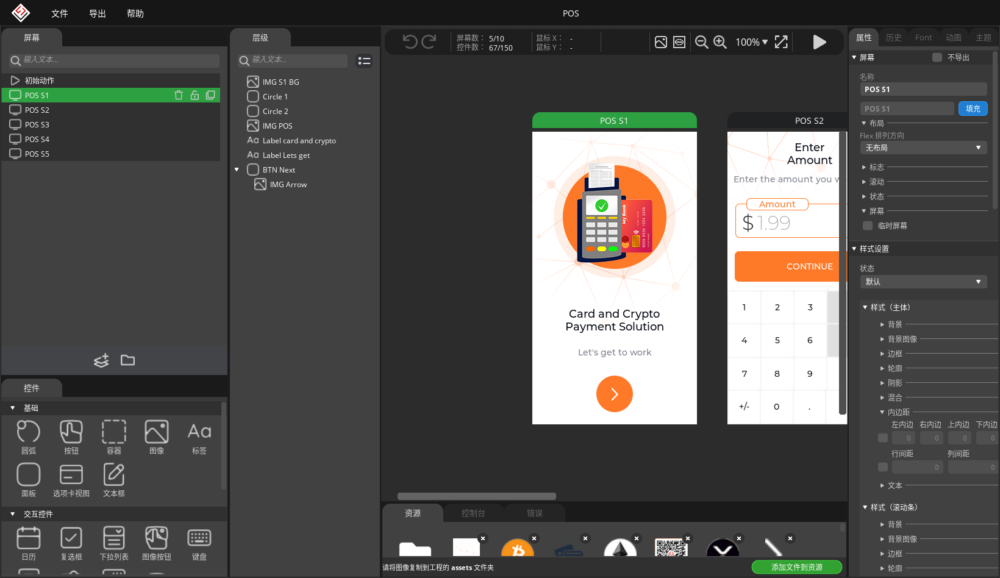

# SquareLine Studio 简体中文汉化工程

面向 **SquareLine Studio 1.6.3 Linux x86_64** 的界面汉化源码。

包含中文词典、中文后备字体接入、Unity UI 渲染补丁生成器、验证脚本，以及中文启动和中英文恢复脚本。



## 已实现

- 启动页、文件和导出菜单、工程设置、偏好设置等主要界面汉化。
- 屏幕、层级、控件、布局、样式、动画和事件等常见属性汉化。
- 1,128 条基础词条，生成 2,501 个显示匹配项和 44 个动态前缀。
- 保留原西文字体，增加中文后备字体。
- 仅在文字绘制和排版计算阶段翻译，可编辑输入、工程属性键、代码模板和导出文本保持原值。
- 原文件备份、版本指纹检查、SHA-256 校验、中英文切换。

开发板介绍、示例画布内容、品牌名称、代码常量和许可协议正文保留原文。第三方新增文字及部分可编辑页签名称可能仍显示英文。

## 使用前提

1. 已在本机安装匹配指纹的 SquareLine Studio 1.6.3 Linux 版本。
2. Python 3 和 Bash；维护版本在 Python 3.14 环境验证。
3. 本机已有 `DroidSansFallbackFull.ttf`。默认位置为 `/usr/share/fonts/truetype/droid/DroidSansFallbackFull.ttf`，也可以通过 `SQUARELINE_CJK_FONT` 指定字体文件。

仓库提供汉化源码和验证材料。原版应用文件、个人日志、代理配置和生成的应用文件不纳入 Git 版本管理，构建时从本地安装读取。

## 构建和启用

先退出 SquareLine Studio，再在本仓库目录执行：

```bash
python3 -m venv .venv
source .venv/bin/activate
python -m pip install -r requirements.txt

# 替换为本机实际的应用安装目录。
export SQUARELINE_APP_DIR="/path/to/SquareLine_Studio_Linux_v1_6_3"

python 汉化补丁/工具/生成词典.py
python 汉化补丁/工具/构建汉化.py
python 汉化补丁/工具/验证汉化.py --built-files
bash 启用中文.sh
bash 启动中文版.sh
```

`SQUARELINE_APP_DIR` 指向应用安装目录，构建产物和原始备份保存在仓库的 `汉化补丁/` 中。构建和验证不会替换当前安装，运行 `启用中文.sh` 时才会安装已校验的产物。

后续在新终端启动时，同样先设置 `SQUARELINE_APP_DIR`。若将仓库文件放在应用安装目录内，可以省略此变量。

已经汉化过的安装需要使用最初的原版备份：将原备份中的两个相对路径复制到本仓库 `汉化补丁/备份/`，再运行构建。构建器会拒绝未知指纹，避免在已修改的文件上重复打补丁。

## 恢复英文

先退出应用，在本仓库目录执行：

```bash
export SQUARELINE_APP_DIR="/path/to/SquareLine_Studio_Linux_v1_6_3"
bash 恢复英文.sh
```

重新启用中文执行 `bash 启用中文.sh`。语言切换只需要系统 Python 3，无需重新安装构建依赖。

## 工程结构

```text
汉化补丁/
  简体中文词典.json          # 生成后的词典
  支持构建指纹.json          # 已验证的原文件指纹
  字体许可.txt
  工具/
    基础词条.tsv             # 编辑词条的主要入口
    界面原文清单.json
    生成词典.py
    构建汉化.py
    切换语言.py
    验证汉化.py
    界面验证.py              # 维护者使用的 X11 界面操作辅助工具
启动中文版.sh
启用中文.sh
恢复英文.sh
docs/
  构建与验证说明.md
  原始验证结果.json
  汉化效果.png
```

## 验证

已在独立 POS 示例副本上验证打开、保存和导出，成功生成 30 个文件。导出的 `lv_label_set_text(ui_Label_Continue, "CONTINUE");` 保留示例原文。

结构验证覆盖生成的 IL 跳转、词典查找、空值和空格、可编辑输入与占位文字、中文字体覆盖，以及原资源保留情况。`Text.text` 的读写方法保持原始字节，只接入三个绘制或排版方法。

详见 [构建与验证说明](docs/构建与验证说明.md) 和 [原始验证结果](docs/原始验证结果.json)。

## 版本范围

本工程只支持 `汉化补丁/支持构建指纹.json` 记录的 1.6.3 文件。其他版本需要重新检查 Unity 程序集、资源结构和界面词条。

本项目为独立的界面本地化工程，与 SquareLine 官方无关联。应用、品牌及第三方字体的权利归其各自权利人；字体许可说明见 `汉化补丁/字体许可.txt`。
